<!-- Every card is an animated SVG drawn by scripts/render_cards.py and refreshed daily by
     .github/workflows/profile-cards.yml. Text (models, featured repos) lives in data/profile.json.
     Spacing is baked into the SVGs: keep this block free of blank lines, and keep the three
     repo cards of a row on one line with no spaces between them. -->
<div align="center">
<a href="https://github.com/TheStack-ai?tab=repositories"></a><br>
<br>
<br>
<br>
<br>
<a href="https://github.com/TheStack-ai/zclean"></a><a href="https://github.com/TheStack-ai/swing-skills"></a><a href="https://github.com/TheStack-ai/jarvis-orb"></a><br>
<a href="https://github.com/TheStack-ai/pulser"></a><a href="https://github.com/TheStack-ai/mrstack"></a><a href="https://github.com/TheStack-ai/waypath"></a><br>
<br>
<a href="https://tokscale.ai/u/TheStack-ai"></a>
</div>

<details>
<summary><b>Architecture: Jarvis AI OS</b></summary>
<br>

> An AI operating system built on top of Claude Code as the kernel.
> 90% of the system was built by Claude Code itself.

```
  ┌─────────────────────────────────────────────────┐
  │  Jarvis Control Plane                           │
  │  Policy Engine · Model Router · 4-Tier Memory   │
  │  Budget Manager · Trust Levels (0-4)            │
  └──────────────────────┬──────────────────────────┘
                         │
  ┌──────────────────────▼──────────────────────────┐
  │  Orchestrator — 22 Agent Teams                  │
  │  Fan-out-fan-in · Quality Gates · Bias Firewall │
  │  Strategy · Code Review · Security · Design     │
  └──────────────────────┬──────────────────────────┘
                         │
  ┌──────────────────────▼──────────────────────────┐
  │  Skills + Hooks                                 │
  │  329 Skill Mappings · 11 Event Hooks            │
  │  Auto-routing · Zero slash commands needed      │
  └──────────────────────┬──────────────────────────┘
                         │
  ┌──────────────────────▼──────────────────────────┐
  │  Claude Code CLI                                │
  │  iTerm2 + tmux 3-pane + Real-time Dashboard     │
  │  Knowledge Graph (Brain) · Telemetry            │
  └─────────────────────────────────────────────────┘
```

| Metric | Count |
|:-------|------:|
| Agent Teams | 22 |
| Agent Prompts | 55 |
| Custom Skills | 28 |
| Plugins | 16 |
| Event Hooks | 11 |
| Skill Mappings | 329 |
| Python LOC | ~6,500 |
| AI Engines | 3 (Claude Fable 5.2, Codex GPT-6.2 Astra, Gemini 4 Carbon) |
| Knowledge Graph Entities | 117 |

</details>

<p align="center">
<i>"Route cheap-first. Hooks are criminally underrated. Memory without consolidation is just noise."</i>
</p>

<p align="center">
<a href="https://www.threads.com/@thestack_ai">threads</a> &nbsp;/&nbsp; <a href="https://thestack-ai.github.io/swing-skills/">swing skills</a> &nbsp;/&nbsp; <a href="https://github.com/sponsors/TheStack-ai">sponsor</a> &nbsp;/&nbsp; <a href="mailto:thekcatsai@gmail.com">thekcatsai@gmail.com</a>
</p>
